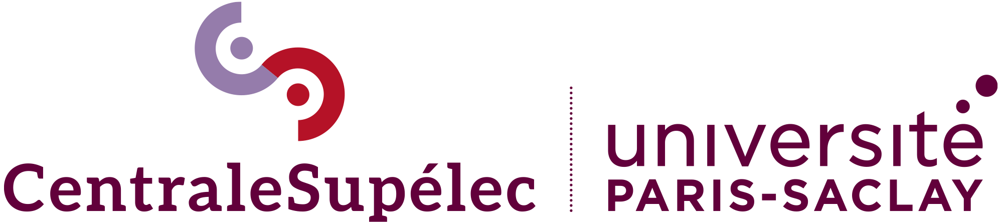
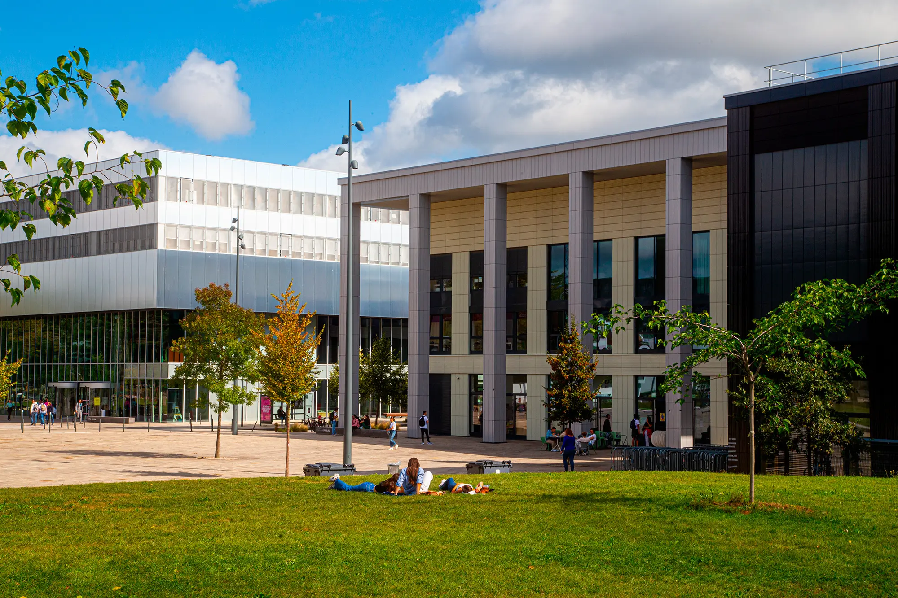

During my PhD I taught engineering and Master students at CentraleSupélec and Université Paris-Saclay.

::: {.teach-card}
::: {}
### Computational structural dynamics

[2023 – 2025 · Teaching assistant]{.tl-date}

- Tutorial sessions in **computational structural dynamics**
- Students of the [Master 2 in Computational Mechanics](https://www.universite-paris-saclay.fr/formation/master/mecanique/m2-modelisation-et-simulation-en-mecanique-des-structures-et-systemes-couples), Université Paris-Saclay (CentraleSupélec)
- 12 hours per year
:::

{fig-alt="CentraleSupélec and Université Paris-Saclay logos"}
:::

::: {.teach-card}
::: {}
### Design for Additive Manufacturing

[2022 – 2024 · Project supervision]{.tl-date}

- Supervision of student projects in the [Séquence Thématique](https://www.centralesupelec.fr/catalogue-de-formations/ingenieur-generaliste-2eme-annee) **Design for Additive Manufacturing** (ST7-81)
- 2nd-year students of the CentraleSupélec engineering programme (1st year of Master level)
- 20 hours per year
:::

{fig-alt="CentraleSupélec campus"}
:::

::: {.teach-card}
::: {}
### Private tutoring

[2019 – 2020 · Le Bon Binôme, Paris]{.tl-date}

- Lessons, revision and exercises for secondary-school pupils, adapted to each student's difficulties
:::

:::
